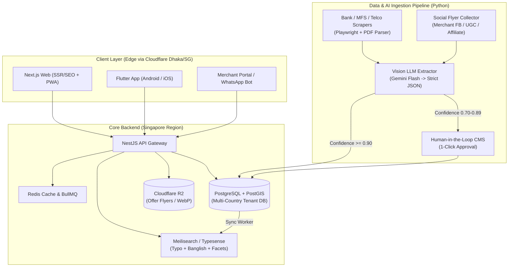

# 06 — Tech Stack & System Architecture

This architecture is designed for **three strict priorities**:
1. **SEO & Mobile Speed in Bangladesh:** Fast load times on 4G Android devices with a Singapore/Mumbai CDN edge (`< 60ms` latency to Dhaka).
2. **Lean Cost:** Runs for **< $100/month** at MVP scale and scales smoothly to 1M+ MAU without a rewrite.
3. **Multi-Country Ready:** Clean separation of country tenants, currencies, languages, and geo-data from Day 1.

---

## 1. Recommended Tech Stack

| Layer | Recommended Choice | Why This Choice (and Trade-offs) |
| :--- | :--- | :--- |
| **Web Frontend (SEO)** | **Next.js (App Router, TypeScript, Tailwind CSS)** | Server-Side Rendering (SSR) + Incremental Static Regeneration (ISR) is **critical for Google SEO** (e.g., `/bd/dhaka/buffet-offers`, `/bd/brands/aarong-offers`, `/bd/banks/city-bank-amex-offers`). Huge hiring pool in Bangladesh. |
| **Mobile Apps (Android & iOS)** | **Flutter** *(Alternative: React Native / Expo)* | **Flutter** gives ultra-smooth 60fps map/list scrolling on budget Android devices (Xiaomi/Realme/Samsung A-series dominate BD), single codebase, strong BD developer ecosystem. *(Pick React Native/Expo instead if your core team is already 100% TypeScript/Next.js and wants to share types/logic.)* |
| **Core Backend API** | **NestJS (TypeScript)** or **Go (Fiber/Gin)** | **NestJS** shares TypeScript models with Next.js and accelerates MVP delivery. **Go** is better if you want ultra-low memory footprint and high concurrency later. For MVP -> Growth, **NestJS + Fastify** is the sweet spot. |
| **Primary Database** | **PostgreSQL 16 + PostGIS** | Rock-solid relational modeling (`merchants`, `outlets`, `offers`, `providers`, `users`) + native **PostGIS** geospatial indexing (`ST_DWithin`) for fast "Near Me" radius queries without paying for a separate geo-DB. |
| **Search Engine** | **Meilisearch** or **Typesense** | Typo-tolerant, sub-20ms instant search supporting **English + Bangla + Banglish synonyms** (e.g., `"kacchi"` / `"বিরিয়ানি"`, `"bkash"` / `"বিকাশ"`), facet filtering (`bank`, `area`, `category`, `discount_type`), and geo-sorting. Much cheaper & simpler than Elasticsearch. |
| **Cache & Job Queues** | **Redis + BullMQ** | Caches hot feeds/trending offers (90%+ read-heavy traffic!) and powers background jobs (expiry sweeps, scraper schedules, push notifications, AI extraction queues). |
| **Data Ingestion & AI Pipeline** | **Python (Playwright + Scrapy + Gemini 2.5 Flash / Lite)** | Python dominates scraping & PDF parsing (`pdfplumber`). **Gemini Flash / Flash-Lite** is extremely cheap and excels at multimodal OCR + structured JSON extraction on messy **Bengali + English promo flyers**. |
| **Maps & Geocoding** | **Mapbox / OpenStreetMap (MapLibre)** + selective Google Places API | Google Maps API gets expensive fast at scale! Use **MapLibre + OpenStreetMap / Protomaps** for rendering maps (near-free) and use Google Places API *only once* per outlet during onboarding to cache verified lat/lng & addresses. |
| **Auth & Notifications** | **Firebase Auth / Supabase Auth + FCM (Firebase Cloud Messaging)** | Free push notifications (FCM), Google Sign-In, Apple Sign-In, plus local Bangladesh SMS OTP gateway (SSL Wireless / BulkSMSBD / GreenWeb) for phone login at ~৳0.30–৳0.45/SMS. |
| **Media & CDN** | **Cloudflare R2 + Cloudflare CDN (Singapore/Dhaka PoP)** | **Zero egress fees** on R2 for storing thousands of compressed WebP offer banners/flyers. Cloudflare has a Dhaka PoP for blazing-fast local delivery. |
| **Payments (Phase 3)** | **SSLCommerz + bKash PGW** | Standard, compliant local payment gateways for merchant boosts/ads and subscriptions in BDT; Stripe for international expansion. |
| **Hosting / Infra** | **AWS Singapore (`ap-southeast-1`)** or **DigitalOcean Singapore / Hetzner** | Singapore has the lowest latency to Bangladesh (~35–55ms via SEA-ME-WE). Start on 2 managed VPS/containers (Coolify/Docker or Railway/Render) -> graduate to AWS ECS/RDS as traffic grows. |

---

## 2. High-Level System Architecture

---

## 3. Core Database Schema (Key Entities)

Designing the schema cleanly prevents painful migrations when scaling to 100K+ offers and multiple countries:

1. **`countries`**: `code` (`BD`), `name`, `currency`, `default_timezone`, `languages[]`
2. **`providers`**: `id`, `country_code`, `type` (`BANK`, `MFS`, `TELCO`, `ECOMMERCE`), `name`, `logo_url`
3. **`provider_tiers`**: `id`, `provider_id`, `name` (e.g., `Amex Gold`, `Visa Signature`, `GPStar Platinum`, `All bKash Users`)
4. **`merchants`**: `id`, `country_code`, `canonical_name`, `aliases[]`, `category_id`, `website`, `fb_page_url`, `is_verified`
5. **`outlets`**: `id`, `merchant_id`, `city`, `zone` (e.g., `Dhanmondi`, `Banani`), `address`, `geom` (`GEOGRAPHY(POINT, 4326)`), `google_place_id`
6. **`offers`**:
   - `id`, `country_code`, `merchant_id`, `title_en`, `title_local`, `description`
   - `offer_type` (`PERCENT_OFF`, `FLAT_OFF`, `BOGO`, `CASHBACK`, `EMI`, `BUNDLE`)
   - `discount_value`, `up_to_flag`, `min_spend`, `max_cap`
   - `redemption_channel` (`IN_STORE`, `ONLINE`, `BOTH`), `promo_code`, `redemption_steps`, `source_url`
   - `starts_at`, `ends_at`, `decay_at`, `status` (`DRAFT`, `ACTIVE`, `SOFT_HIDDEN`, `EXPIRED`)
   - `verification_level` (`MERCHANT_VERIFIED`, `INSTITUTIONAL`, `AI_PARSED`, `COMMUNITY`)
   - `upvotes`, `expired_reports`, `last_verified_at`
7. **`offer_eligibility`**: Many-to-many linking `offer_id` -> `provider_id` / `provider_tier_id` (or `PUBLIC` for open-to-all deals)
8. **`offer_outlets`**: `offer_id`, `applies_to_all_outlets`, `included_outlet_ids[]`, `excluded_outlet_ids[]`

---

## 4. Performance & SEO Engineering Must-Haves

- **Programmatic SEO Pages (Massive Free Traffic):** Automatically generate clean, fast SSR landing pages for high-intent local queries:
  - `/bd/offers/bkash-cashback`
  - `/bd/offers/city-bank-amex-buffet`
  - `/bd/dhaka/dhanmondi/restaurant-offers`
  - `/bd/brands/aarong-discount`
  - `/bd/events/ramadan-iftar-buffet-offers-dhaka`
- **Image Optimization:** Convert all scraped/uploaded flyers to compressed **WebP/AVIF** (< 60KB) via Cloudflare Images / Sharp so the app feels instant even on slow 3G/4G connections.
- **Offline-First Caching in Flutter:** Cache the user's saved offers and "My Wallet" matches locally (SQLite/Hive) so when they walk into a basement restaurant or mall with poor cellular reception, they can still pull up the offer and promo code!
